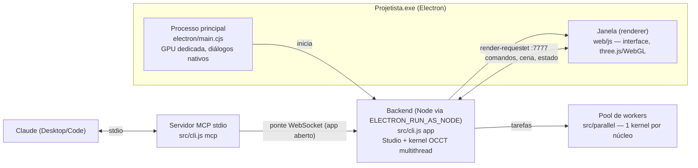

# Arquitetura

## Processos



- **Processo principal** (`electron/main.cjs`): força a GPU dedicada, sobe o backend com heap de ¼ da RAM
  (até 16 GB) e abre a janela com a barra de título integrada. Também atende os diálogos nativos de arquivo.
- **Backend** (`src/cli.js app` → `Studio` + `server/hub.js`): dono do documento. Expõe HTTP (arquivos
  estáticos, upload, `/api/info`) e WebSocket na porta 7777.
- **Interface** (`web/`): cliente do WebSocket. Também é o **renderizador GPU**: quando o Claude pede uma
  imagem, o hub envia `render-request` à janela, que desenha com WebGL e devolve o PNG.
- **Servidor MCP** (`src/cli.js mcp`): se `/api/info` responde na porta, vira uma **ponte**
  (`src/mcp/bridge.js`) para o app aberto. Senão, cria o próprio `Studio` e hub, e renderiza por software
  (`src/render/raster.js`).
- **Passagem de controle do kernel**: `/api/info` informa o dono (`owner: "app"` ou `"mcp"`). Se o app
  desktop abre e encontra um kernel do MCP na porta, ele chama `POST /api/handover`. O kernel do MCP devolve o
  documento, libera a porta e passa a operar como ponte. O app grava o documento recebido como salvamento
  automático e sobe o próprio kernel. Se o app fechar, a ponte cai e o MCP retoma o kernel com o documento
  salvo pelo app (`tests/handover.mjs`). Um kernel de versão antiga, sem essa passagem, faz o app subir o
  próprio kernel na próxima porta livre.
- **Transações órfãs**: se a janela que abriu um comando (transação) se desconecta, o hub conclui a transação
  para o documento não ficar preso em modo de edição.
- **Workers** (`src/parallel/`): cada um carrega o OpenCascade em modo de uma thread e regenera variantes do
  documento (estudos e otimização). São encerrados após 60 s ociosos.

## Módulos

| Caminho | Responsabilidade |
|---|---|
| `src/occ/occ.js` | Camada sobre o OpenCascade (WASM): primitivas, booleanas paralelas, filete/chanfro, casca, offset, saída, loft, varredura, tesselagem, propriedades de massa, distâncias, STEP, HLR |
| `src/occ/body.js` | `Solid`: forma B-rep + malha de exibição preguiçosa e qualidades de tesselagem |
| `src/occ/select.js` | Seletores semânticos de faces e arestas (intenção, não índices) |
| `src/core/sketch.js` | Expansão de formas, solver de restrições (Levenberg–Marquardt, DOF/redundância) e extração de perfis exatos |
| `src/core/features.js` | As 31 features: cada uma é JSON → operação no kernel |
| `src/core/document.js` | Parâmetros, linha do tempo, regeneração incremental, desfazer/refazer, transações, versões, configurações |
| `src/core/expr.js` | Avaliador seguro de expressões (unidades, funções, parâmetros, detecção de ciclos) |
| `src/core/analysis.js` | Massa/inércia, interferência, folga, seção, medições, checagem de impressão 3D |
| `src/core/io.js` | STL, OBJ, 3MF, GLB |
| `src/render/` | Renderizador por software (PNG) e desenho técnico SVG por HLR |
| `src/studio.js` | Conjunto único de comandos usado por MCP, interface e ponte |
| `src/server/hub.js` | HTTP + WebSocket, difusão da cena e do estado, upload, renderização GPU sob demanda |
| `src/mcp/` | Ferramentas MCP, ponte para o app e manual de modelagem |
| `web/js/` | Interface: `main`, `ribbon`, `browser`, `panel`, `commands`, `sketcher`, `viewport`, `dialogs`, `icons`, `store`, `rpc`, `ui`, `examples` |

## Modelo de documento

Um documento é JSON puro (`.projetista`):

```json
{
  "format": "projetista/1",
  "name": "Suporte",
  "parameters": { "L": { "expr": 80 }, "W": { "expr": "L/2" } },
  "features": [
    { "type": "sketch", "name": "Esboço1", "plane": "XY", "shapes": [{ "type": "rect", "center": [0, 0], "width": "L", "height": "W" }] },
    { "type": "extrude", "name": "Extrusão1", "sketch": "Esboço1", "distance": 10, "body": "Base" },
    { "type": "fillet", "name": "Filete1", "body": "Base", "edges": { "type": "line", "parallel": "z" }, "radius": 4 }
  ],
  "rollback": null,
  "configurations": { "G": { "L": 120 } },
  "versions": []
}
```

### Regeneração incremental

Cada passo `i` da linha do tempo tem uma chave `sha1(chave(i−1) + JSON(feature i))`. A chave inicial inclui
os valores avaliados de todos os parâmetros, a resolução e o material padrão. Se a chave do passo coincide
com a do cache, o estado depois dele (mapas de corpos e esboços) é reaproveitado sem recalcular. Os objetos
WASM criados em cada passo pertencem a uma `Arena`, liberada quando o passo deixa de valer.

### Transações

Os comandos interativos usam `tx_begin`, depois várias chamadas `add_feature`/`update_feature` (a
pré-visualização ao vivo) e por fim `tx_commit` ou `tx_cancel`. O commit junta as entradas de desfazer numa
só. O cancelamento restaura o instantâneo inicial.

### Seleção por intenção

Faces e arestas são descritas por propriedades geométricas (`{ normal: "+z", pick: "max" }`,
`{ type: "circle", radius: 3 }`, `{ near: [x, y, z] }`), reavaliadas a cada regeneração. Isso contorna o
problema de nomeação topológica. Ao clicar na tela, a interface converte o clique no ponto médio exato da
aresta (ou no centróide da face) e grava `near`.

## Protocolo WebSocket

| Direção | Mensagem | Conteúdo |
|---|---|---|
| cliente → hub | `{ id, cmd, args, source? }` | qualquer comando de `Studio.run` (`source: "claude"` marca ações da ponte) |
| hub → cliente | `{ type: "reply", id, ok, result \| error }` | resposta (`png` vira `image` base64) |
| hub → todos | `{ type: "scene", version, bodies[], sketches[] }` | malha (`positions`, `indices`), `faceIds` por triângulo, arestas exatas (`edges`, `edgeIds` por segmento) |
| hub → todos | `{ type: "state", state }` | parâmetros, linha do tempo e status, corpos, desfazer/refazer, transação, materiais |
| hub → todos | `{ type: "activity", activity }` | ação registrada (`source`: `ui`, `claude`, `api`) |
| HTTP | `GET /api/info` · `POST /api/handover` · `POST /api/upload?name=` · `GET /files/<caminho>[?download]` | dono do kernel, passagem de controle, importação e download de arquivos da pasta de projetos |
| cliente → hub | `{ type: "register", role: "gpu-renderer", desktop }` | a janela se oferece para renderizar (a do app desktop tem prioridade) |
| hub → cliente | `{ type: "render-request", id, version, opts }` | pedido de imagem para o Claude |
| cliente → hub | `{ type: "render-result", id, ok, image, width, height, views, gpu }` | PNG renderizado na GPU |

## Precisão

- Geometria B-rep exata em dupla precisão, tolerância de confusão de 1e-7 mm.
- Volume, área, CG e inércia por integração de Gauss sobre as superfícies exatas (`eps = 1e-9`). O tensor de
  inércia é montado a partir de momentos sobre eixos, porque o build não expõe `gp_Mat`. Os momentos
  principais vêm de autovalores por Jacobi.
- Seções por meio-espaço exato. Distâncias por `BRepExtrema`. Desenho por `HLRBRep`.
- A malha só é usada para exibição, checagem de impressão e exportação STL/3MF, com erro cordal controlado.
- Verificações analíticas automatizadas em `tests/smoke.mjs` e `tests/kernel.mjs`.

## Empacotamento

- `electron-builder` com `asar: false` (os arquivos `.wasm` e os workers são lidos do disco).
- O electron-builder exclui pastas `examples/` de `node_modules`, por isso os addons do three.js usados pela
  interface estão em `web/vendor/addons/`.
- O MCP do app instalado roda como `Projetista.exe resources/app/src/cli.js mcp` com
  `ELECTRON_RUN_AS_NODE=1`, ou seja, o Node embutido no Electron, sem precisar instalar o Node.
